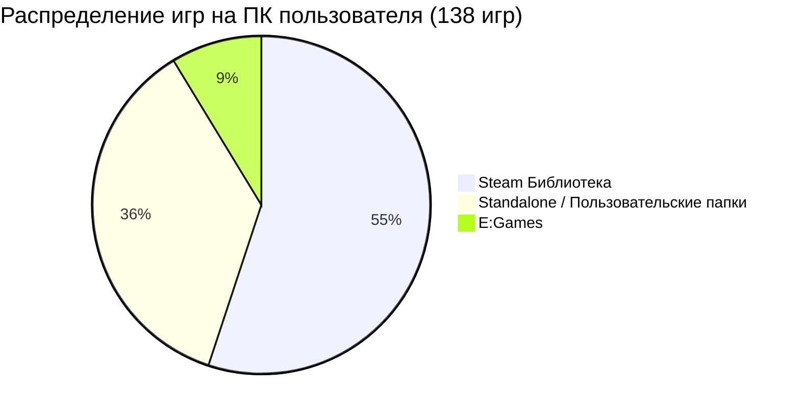
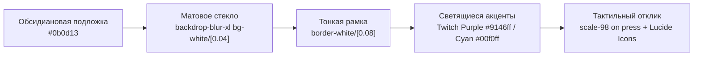

# 📋 Техническое Задание (ТЗ / PRD v3.1): Twitch Drops Sentinel [Apple Liquid Glass Edition]

**Версия документа:** 3.1.0-ULTIMATE  
**Автор проекта:** Mortuis_V / Mortuis_V_Studio  
**Стек технологий:** React 19 + TypeScript + Vite + Tailwind CSS v4 + Lucide Icons + WebView2 / C# .NET 10 Host + Python Smartbox GQL Core  
**Дизайн-эталон:** `C:\AI Local Projects\Ideas\Apple Style Shutdown Utility v2` (Luna)  
**Дата актуализации:** 2026-10-03  

---

## 🌟 1. Видение и Главная Концепция

**Twitch Drops Sentinel v3.0** — персональный премиальный программный комплекс нового поколения, совмещающий:
1. **Эстетику Apple Liquid Glass / Frosted Obsidian** (глубокий матовый блюр, стеклянные карточки Bento, светящиеся неоновые акценты Twitch Purple `#9146ff` и Cyber Cyan `#00f0ff`, плавная физика пружин 60+ FPS, как в нашей утилите `Luna`).
2. **Монолитную сборку в один `.exe` файл (`TwitchDropsSentinel.exe`)** с внедрённой фирменной 3D-иконкой Cyber Shield, системным треем и темным заголовком Windows 11/10 DWM.
3. **Глубокую интеграцию с библиотекой ПК пользователя (138 игр найдено):**
   - 76 игр из Steam (`C:\Program Files (x86)\Steam`, `E:\SteamLibrary`).
   - 12 игр из `E:\Games` (включая *Hearthstone, StarCraft II, RDR2, AC Valhalla, Death Stranding*).
   - 50 игр из Standalone / Пользовательских папок (включая *God of War Ragnarok, Horizon Forbidden West, Spider-Man 2, The Last of Us, Warhammer Mechanicus II, NFS Unbound*).
4. **Умный аппаратный страж (Sentinel Hardware Guard):**
   - Автоматическая пауза при запуске любой из 138 установленных игр (пинг и видеокарта полностью свободны).
   - ЭКО-режим при отключении ноутбука от сети (контроль батареи).
   - Функция **Auto-Shutdown / Auto-Sleep** (автоматическое выключение или усыпление ПК по завершении всех запланированных дропсов — прямая синергия с функционалом утилиты `Luna`).
5. **Бесстримовое ядро без нагрузки на систему (Streamless Engine):**
   - Прямой протокол Twitch Smartbox GQL (`ue6666qo983tsx6so1t0vnawi233wa`) + WebSocket.
   - Экономия 99.8% трафика и 0% нагрузки на GPU (трафик не качает видео, счётчик сэкономленных гигабайт в реальном времени).
   - Автоматический сбор **Twitch Channel Points** (баллов каналов) с балансом и статистикой.
6. **Витрину трофеев (Trophy Vault Gallery):**
   - 3D-карточки полученных скинов и предметов с фильтрами, экспортом и нативными тостами Windows 10/11.

---

## 🎮 2. Полный Реестр Игр Пользователя (138 игр на ПК)

Sentinel v3.0 оснащён автоматическим модулем `LocalGameScanner`, который при запуске сканирует ПК и формирует базу:

### 2.1. Топ-игры со сверхпопулярными Twitch Drops на ПК пользователя:
* **`Path of Exile 2`** (`PathOfExile2.exe`) — крупнейшие дропсы (порталы, плащи, микротранзакции).
* **`Hunt: Showdown 1896`** (`HuntGame.exe`) — легендарные охотники, винтовки и брелоки.
* **`Hearthstone`** (`Hearthstone.exe` из `E:\Games`) — паки карт и портреты героев за просмотр турниров.
* **`StarCraft II`** (`StarCraft II.exe` из `E:\Games`) — комментаторы, скины юнитов и портреты.
* **`No Man's Sky`** — экспедиционные корабли и мультитулы.
* **`The Witcher 3: Wild Hunt`** — комплекты брони и снаряжение.
* **`Frostpunk 2`**, **`inZOI`**, **`Hades II`**, **`Project Zomboid`**, **`Warhammer 40k`**, **`Terraria`**.

### 2.2. Защищённые синглплеерные блокбастеры (внесены в Hardware Guard):
* `GoWR.exe` (God of War Ragnarok)
* `HorizonForbiddenWest.exe` (Horizon Forbidden West)
* `Spider-Man2.exe`, `MilesMorales.exe` (Marvel's Spider-Man)
* `RDR2.exe` (Red Dead Redemption 2)
* `ACValhalla.exe` (Assassin's Creed Valhalla)
* `Hellblade2.exe` (Senua's Saga Hellblade II)
* `NeedForSpeedUnbound.exe` (NFS Unbound)
* `Mechanicus2.exe` (Warhammer 40,000 Mechanicus II)
* `TheAlters.exe`, `Xenonauts 2.exe` и др.

### 2.3. Глобальная предзагруженная база Twitch Drops (120+ игр):
* **Шутеры & Battle Royale:** Rust, CS2, Escape from Tarkov, Valorant, Apex Legends, PUBG, Rainbow Six Siege, The Finals, Delta Force.
* **MMO & ARPG:** Diablo IV, World of Warcraft, Warframe, Destiny 2, Ark, Conan Exiles, Palworld, Helldivers 2, Dune: Awakening.
* **MOBA:** Dota 2, League of Legends, Marvel Rivals, Dead by Daylight.
* **Gacha:** Genshin Impact, Honkai: Star Rail, Zenless Zone Zero.

---

## 🎨 3. Архитектура и Дизайн-Система (Apple Glassmorphism)

По образцу `Apple Style Shutdown Utility v2`:

### Экраны интерфейса:
1. **⚡ Обзор (Live Drops Dashboard):**
   - **Bento Card №1 (Центральная):** Текущий активный дроп, анимированный круговой индикатор прогресса (например, `74%`), таймер до завершения (`Осталось 16 мин`), имя стримера, кнопка переключения канала.
   - **Bento Card №2 (Sentinel Hardware Guard):** Статус защиты: `🛡️ В строю | Игры: 0 запущено | Сеть: 28 ms | Батарея: 100% 🔌`.
   - **Bento Card №3 (Stealth & Eco Stats):** `Сэкономлено трафика: 24.8 ГБ`, `GPU: 0%`, `Нафармлено баллов канала: 12,450`.
   - **Bento Card №4 (Auto-Shutdown Timer):** Тумблер в стиле Luna: *«Выключить ПК после завершения очереди фарма»* с таймером отсчёта.

2. **🎮 Полка Игр (Interactive Game Shelf):**
   - Табы фильтрации: **«💾 Установлено на ПК (138)»**, **«🔥 С активными Drops»**, **«Все игры (120+)»**.
   - Поиск в реальном времени с подсветкой результатов.
   - Карточки игр с баннерами: бейджик *«Установлено»*, кнопки *«В приоритет ➕»* и *«В исключения 🚫»*.

3. **🏆 Витрина Трофеев (Trophy Vault Museum):**
   - Галерея карточек всех забранных предметов.
   - Превью иконки предмета, название игры, кампания, точная дата забора, статус `✅ Забран на аккаунт`.
   - Кнопка *«📂 Экспорт истории (Trophies.md)»*.

4. **⚙️ Студия Настроек (Settings Studio):**
   - Управление сессией Twitch (отображение никнейма, ID, статус cookies).
   - Список процессов автопаузы (с кнопкой *«Синхронизировать с моими 138 играми»*).
   - Настройка порога батареи ноутбука.
   - Выбор языка (Русский / English).

---

## 🤖 4. Задание для Ночных Работяг (7 Пользовательских Историй в `prd.json`)

| ID | Название User Story | Что делают субагенты | Критерий завершения (Exit 0) |
| :---: | :--- | :--- | :--- |
| **US-001** | **Инициализация Scaffolding** | Развёртывание проекта React 19 + Tailwind v4 + Vite + C# .NET 10 WebView2 host в `Ideas/Twitch Drops Sentinel v3` | `npm run build` и `dotnet build` завершаются с кодом 0 |
| **US-002** | **Apple Glass UI по образцу Luna** | Вёрстка Bento Grid, шапки Sentinel HUD, карточек дропсов, полки игр и витрины трофеев на Lucide Icons | 100% соответствие стилю Luna, плавные анимации, отсутствие багов верстки |
| **US-003** | **Интеграция Ядра Smartbox & IPC** | Подключение бесстримового движка Twitch GQL/WebSocket через IPC bridge, чтение сессии из `cookies.jar` | Сессия подхватывается без ввода логина, отображается текущий прогресс дропсов |
| **US-004** | **Модуль Сканирования 138 Игр** | Реализация универсального сканера Steam + Epic + GOG + пользовательские директории + база 120 Twitch игр | Игры с ПК отображаются в UI с бейджем «💾 Установлено», работает поиск |
| **US-005** | **Hardware Guard & Luna Auto-Sleep** | Фоновый поток `psutil` с мониторингом 138 exe-файлов и батареи + таймер автовыключения ПК при завершении | При запуске игры фарм встает на паузу, при закрытии продолжается; таймер выключения работает |
| **US-006** | **Trophy Vault & WinRT Toasts** | Запись трофеев в `Trophies.md` / JSON, рендер галереи карточек, всплывающие уведомления Windows | Каждый полученный дроп отображается в витрине и даёт уведомление Windows |
| **US-007** | **Сборка Standalone `TwitchDropsSentinel.exe`** | Компиляция в единый монолитный исполняемый файл с 3D-иконкой Cyber Shield и скрытием в трей | `TwitchDropsSentinel.exe` запускается в 1 клик, не открывает чёрных консолей, работает трей |

---

## 🛡️ 5. Железные Правила для Агентов (Circuit Breakers)
1. **Сохранность Данных:** Файл `cookies.jar` с активной авторизацией пользователя неприкосновенен.
2. **Никакого AI-Slop:** Запрещены стандартные серые формы и библиотеки без стилей. Только эстетика Apple Glassmorphism.
3. **Безупречная Верификация:** Ни одна задача не считается выполненной без прогона тестов и проверки кода завершения (`exit code 0`).
