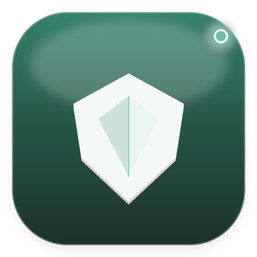
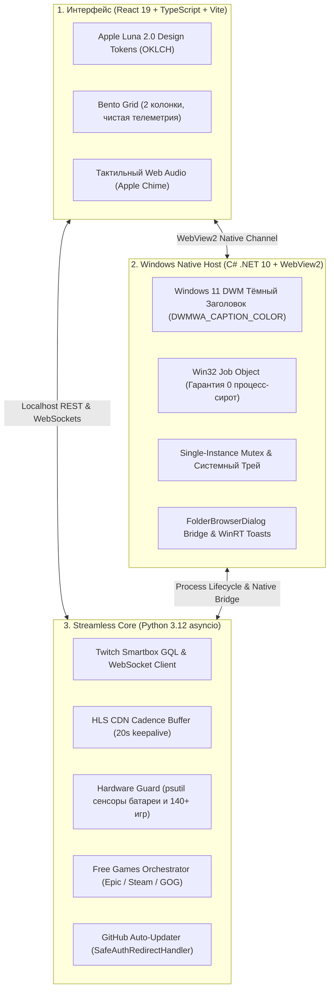

# 🛡️ Twitch Drops Sentinel v3.1

<div align="center">



### Автономный streamless-комбинат для фарма наград Twitch Drops с 0% нагрузки на GPU
*Премиальная десктопная утилита в эстетике Apple Luna 2.0. Сделано с любовью в Mortuis_V_Studio.*

[](https://github.com/MortuisVMain/Twitch-Drops-Sentinel/releases/latest)
[](https://github.com/MortuisVMain/Twitch-Drops-Sentinel)
[](https://microsoft.com/windows)
[](https://github.com/MortuisVMain/Twitch-Drops-Sentinel)
[](https://github.com/MortuisVMain/Twitch-Drops-Sentinel)
[](LICENSE)

[📦 Скачать релиз v3.1.0](https://github.com/MortuisVMain/Twitch-Drops-Sentinel/releases/latest) • [⚡ Быстрый старт](#-быстрый-старт-за-1-минуту) • [📖 Инструкция](ИНСТРУКЦИЯ.md) • [🛠 Архитектура](#-архитектура-системы)

</div>

---

## ⚡ О проекте

**Twitch Drops Sentinel** — это автономное настольное приложение для Windows, созданное для тихого автоматического фарма наград (Drops) на Twitch без необходимости держать открытым тяжелый веб-браузер.

В отличие от браузерного просмотра, Sentinel взаимодействует напрямую с **Twitch GraphQL & Spade Telemetry API** на протокольном уровне:
* **0% нагрузки на GPU:** Видеопоток не скачивается и не декодируется. Видеокарта полностью свободна для тяжелых игр, стриминга или 3D-рендеринга.
* **Экономия до 98% интернет-трафика:** Расход сети снижается с ~3.2 ГБ/час до скромных ~5 МБ/час (только зашифрованные heartbeat-сигналы присутствия).
* **GitHub Auto-Updater (Обновления в 1 клик):** Встроенный модуль проверки обновлений и применения горячих патчей (1.4 МБ) прямо из интерфейса. Сессионные файлы (`cookies.jar`, `Trophies.md`, `config.json`) гарантированно сохраняются при любых апдейтах.
* **2-колоночный Bento Grid:** Просторный и чистый интерфейс Apple Luna 2.0 без бутафорских карточек — только 100% реальные измеренные метрики системы.
* **Hardware Guard (Автопауза при гейминге):** При запуске любой тяжелой игры Sentinel автоматически ставит опрос на паузу для 100% плавности фреймрейта и нулевого пинга, а после закрытия игры сам возобновляет сбор наград.
* **Free Games Claimer (Хаб Бесплатных Раздач):** Мониторинг и автоматический сбор раздач бесплатных игр с 7 ключевых платформ (Epic Games, Steam, GOG, Prime Gaming, itch.io).
* **Luna Auto-Shutdown:** Автоматическое выключение, переход в сон или блокировка компьютера после завершения всех запланированных дроп-кампаний (идеально для ночного фарма).
* **Универсальный GameScanner:** Автоматическое обнаружение установленных игр пользователя со всех дисков (библиотеки Steam, Epic Games, GOG Galaxy и настраиваемые пользовательские папки).

---

## 🏗️ Архитектура системы

Комплекс построен по гибридной трёхконтурной архитектуре, объединяющей максимальную производительность рабочего стола и гибкость реверс-инжиниринга:



---

## 🎨 Дизайн и интерфейс (Apple Luna 2.0)

Интерфейс построен по каноническому дизайн-контракту **Apple Luna 2.0**:
* **Глубокая палитра Obsidian & Noble Mint:** `#171d1c` (фон), `#202725` (поверхность), `#303a35` (тонкие линии), `#73bba5` / `#368873` (мятный благородный акцент).
* **Bento Grid:** адаптивная двухколоночная сетка карточек с живой телеметрией процессора, состояния батареи и сетевого пинга.
* **Тактильный Web Audio:** процедурный звуковой движок обратной связи при переключении разделов и сигнал Apple Chime при зачислении каждого нового предмета (с тумблером моментального Mute в Topbar).
* **Запоминание геометрии окна:** умное восстановление размеров и положения на экране (`data/window_state.json`).

---

## 🚀 Быстрый старт за 1 минуту

### Вариант 1: Запуск готового Portable-дистрибутива (Рекомендуется)
1. Скачайте архив релиза **[`Twitch_Drops_Sentinel_v3.1_Public_Release.zip`](https://github.com/MortuisVMain/Twitch-Drops-Sentinel/releases/latest)**.
2. Распакуйте в любую папку на диске (например, `C:\Games\Sentinel`).
3. Запустите **`TwitchDropsSentinel.exe`**.
4. При самом первом запуске откроется страница `https://www.twitch.tv/activate` — подтвердите одноразовый безопасный код OAuth Device Code.
5. Готово! Sentinel сразу начнёт автономный фарм наград.

> [!NOTE]
> Все зависимости и портативный Python уже встроены в архив. Никаких дополнительных установок или настроек среды не требуется.

### Вариант 2: Запуск из исходного кода
```powershell
# 1. Клонирование репозитория
git clone https://github.com/MortuisVMain/Twitch-Drops-Sentinel.git
cd Twitch-Drops-Sentinel

# 2. Установка зависимостей интерфейса и сборка бандла
npm ci
npm run build

# 3. Установка Python зависимостей
pip install -r requirements.txt

# 4. Сборка C# хоста и запуск
dotnet run --project desktop/TwitchDropsSentinel.csproj
```

---

## 🛡️ Безопасность и Приватность

* **Пароли не требуются:** Авторизация построена на официальном протоколе **Twitch OAuth Device Authorization Grant**. Вы подтверждаете вход прямо в вашем обычном веб-браузере на серверах Twitch.
* **Полная изоляция данных:** Файлы сессии (`cookies.jar`), журнал трофеев (`Trophies.md`) и конфигурация (`config.json`) хранятся исключительно локально на вашем ПК и добавлены в `.gitignore`. Они никогда не отправляются на сторонние серверы.
* **Zero Telemetry Leak:** Все диагностические отчёты перед отправкой или копированием автоматически вырезают любые упоминания токенов авторизации (`oauth:[REDACTED]`).

---

## 🧪 Тестирование и Надежность

Проект сопровождается всеобъемлющим комплексом из **24 строгих шлюзов верификации** (`test_sentinel_suite.py`):
```powershell
python test_sentinel_suite.py
```

* **Шлюзы охватывают:**
  - Целостность монолитного исполняемого файла и бандла `dist/index.html`.
  - Отсутствие Mojibake и искажений кодировки CP1251 во всех Python-файлах и логах.
  - Устойчивость парсинга кампаний (фильтрация истекших дропсов, защита от флаппинга стримеров).
  - Датчики Hardware Guard и контроль автопаузы при гейминге.
  - Точность сканера библиотек Steam, Epic Games и GOG Galaxy.
  - Полный цикл работы GitHub Auto-Updater и горячих патчей.

---

## 📄 Лицензия

Распространяется под свободной лицензией **MIT License**. См. файл [LICENSE](LICENSE) для подробностей.  
Разработано исключительно в исследовательских и образовательных целях.

---

<div align="center">
<sub>Crafted with precision by Mortuis_V_Studio • 2026</sub>
</div>
