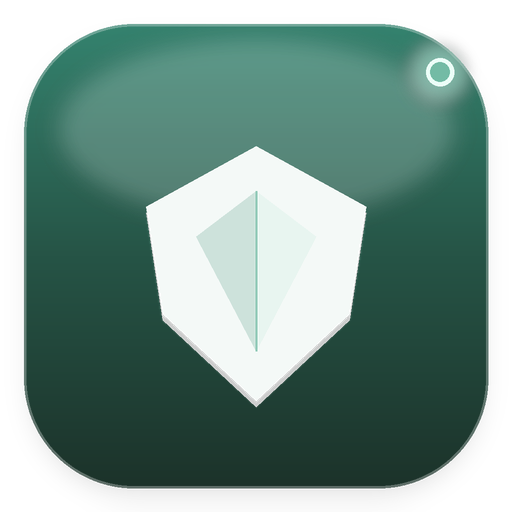
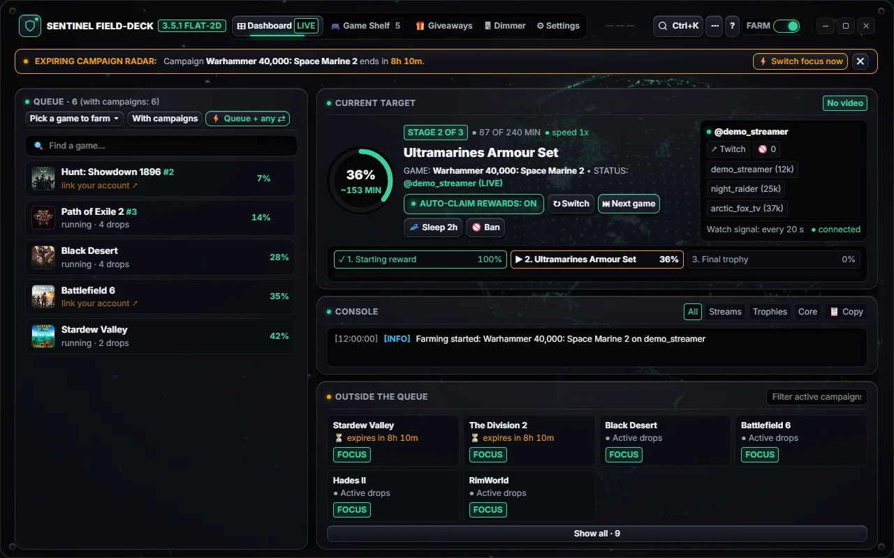
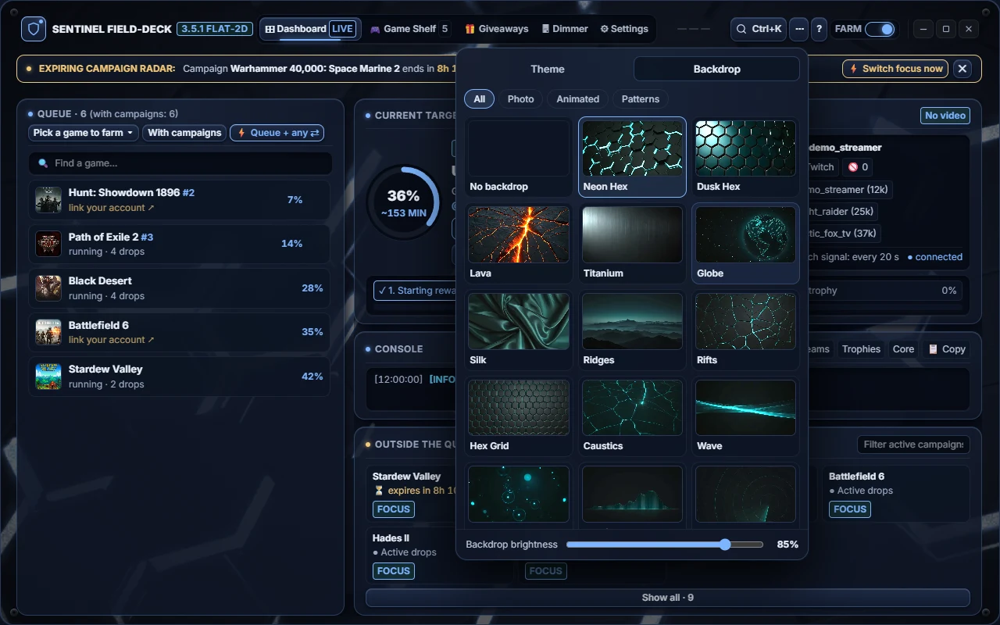
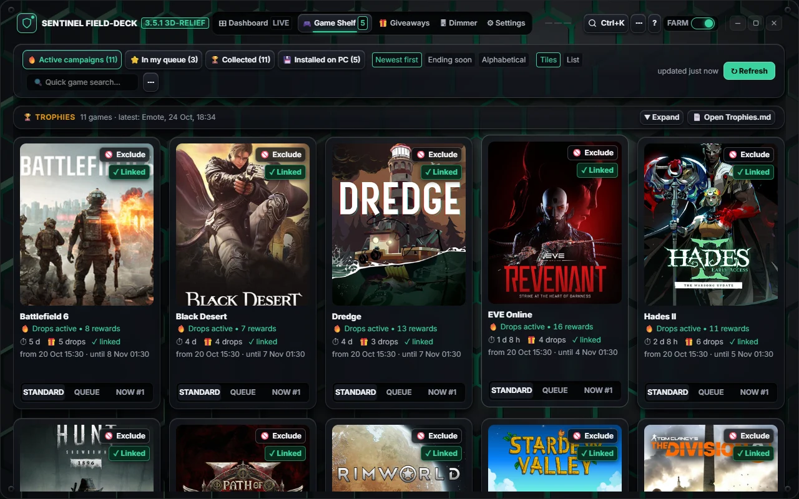
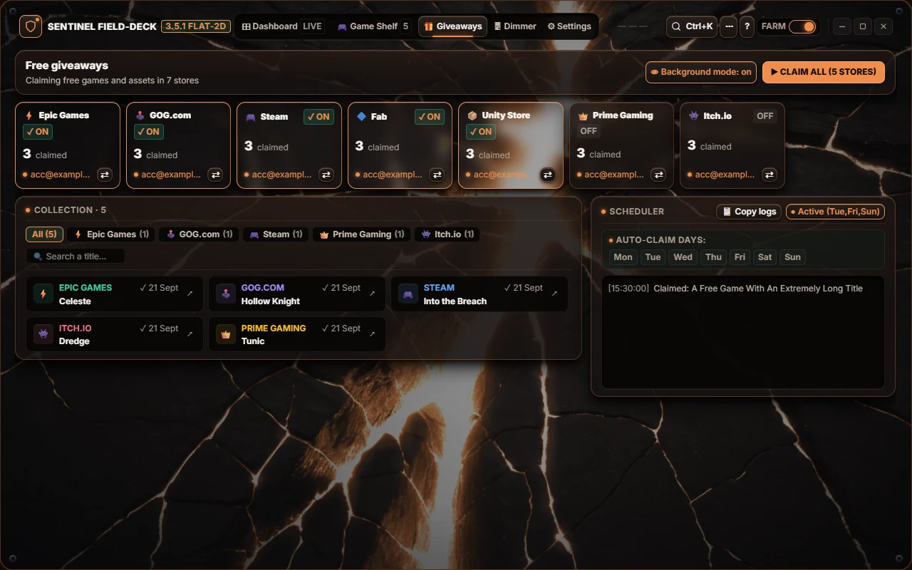
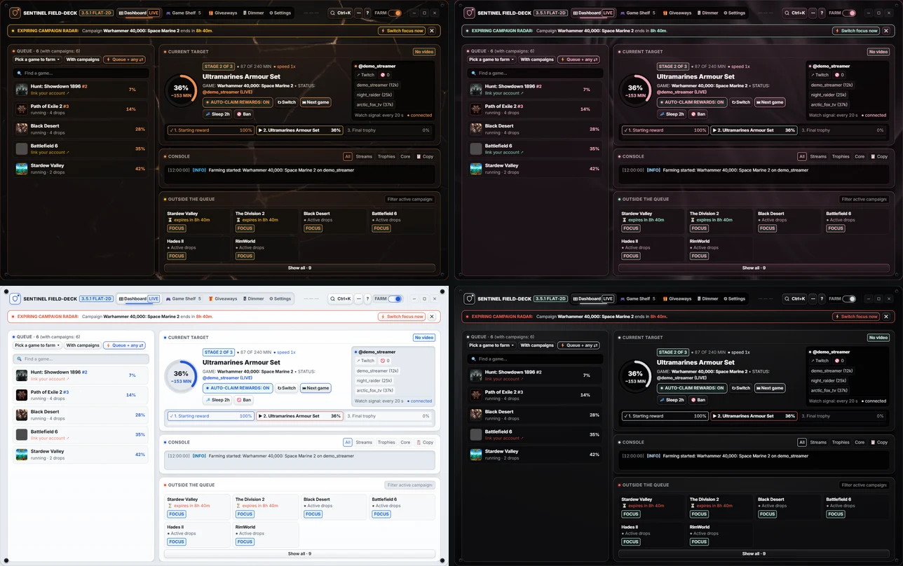
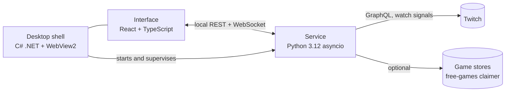

<div align="center">



# Twitch Drops Sentinel

**Farm Twitch Drops in the background on Windows, without playing the video.**

**English** · [Русский](README.ru.md)

[](https://github.com/MortuisVMain/Twitch-Drops-Sentinel/releases/latest)
[](https://github.com/MortuisVMain/Twitch-Drops-Sentinel/releases)
[](https://github.com/MortuisVMain/Twitch-Drops-Sentinel/actions/workflows/ci.yml)

[](#license)

[**Download for Windows**](https://github.com/MortuisVMain/Twitch-Drops-Sentinel/releases/latest)

</div>



Sentinel is a desktop app that collects Twitch Drops for you. Pick the games you care about, and it finds live channels with drops enabled, keeps your watch progress going and claims the rewards. No browser tab, no video stream: Twitch sees the same "minute watched" signals a player sends, so your GPU stays free for games and the traffic stays small.

## Features

- **Drops without the video.** Sentinel never downloads or decodes the stream. It sends watch signals and checks the stream playlist, which is enough for drop progress.
- **Priority queue.** Put games in the order you want. Three modes: your list only, your list first and then any other campaign, or rare and soon-ending drops first.
- **Automatic claiming.** Rewards are claimed as soon as they are ready and land in your trophy log. Channel points bonus chests are collected on the way.
- **Game Shelf.** All active campaigns with covers, rewards, deadlines and progress. Installed games from Steam, Epic Games and GOG Galaxy (and your own folders) are detected automatically.
- **Stays out of your way.** Farming pauses while you play a heavy game or run on battery, and resumes afterwards. When everything is collected, Sentinel can put the PC to sleep or shut it down.
- **Free games.** An optional claimer picks up weekly giveaways on Epic Games, GOG, Steam, Fab, Unity Asset Store, itch.io and Prime Gaming on a schedule.
- **Screen dimmer.** Dim one or all monitors below the hardware minimum, with a blackout mode for night farming.
- **Looks the way you like.** 11 themes, 29 backdrops (including 17 photoreal ones that recolor to the theme), English and Russian interface, text size from 70 to 130 %.
- **Updates itself.** New versions install from GitHub Releases in one click; your login, settings and trophy log are kept.

## Screenshots

| Appearance: themes and backdrops | Game Shelf |
|---|---|
|  |  |
| **Free games** | **Themes: Copper, Sakura Night, Paper, Graphite OLED** |
|  |  |

## Install

1. Download `Twitch_Drops_Sentinel_v…_Public_Release.zip` from the [latest release](https://github.com/MortuisVMain/Twitch-Drops-Sentinel/releases/latest).
2. Unzip it into any folder you can write to, for example `C:\Games\Sentinel`.
3. Run `TwitchDropsSentinel.exe`.
4. Sign in: Sentinel opens [twitch.tv/activate](https://www.twitch.tv/activate) with a one-time code. Confirm it in your browser; your password never goes through the app.

**Requirements:** Windows 10 or 11 (64-bit) and the Microsoft Edge WebView2 Runtime, which Windows 11 already has (Sentinel offers the download if it is missing). Python is bundled. The Giveaways tab additionally needs [Node.js](https://nodejs.org/) 20 or newer; it is not included in the download, and nothing else in the app needs it. The tab's browser engine installs itself on first use.

> [!TIP]
> To get drops for a game, your Twitch account usually has to be linked to the game's account. Sentinel marks such campaigns with "link your account".

## FAQ

<details>
<summary><b>Windows SmartScreen says the app is unrecognized</b></summary>

The executable is not code-signed, so SmartScreen warns on first launch. Click **More info → Run anyway**. You can also check the source and build it yourself (see below).
</details>

<details>
<summary><b>Do I need to keep the stream or a browser open?</b></summary>

No. Sentinel works on its own; you can minimize it to the tray. Closing the window asks whether to keep farming in the tray or quit.
</details>

<details>
<summary><b>Where is my data stored?</b></summary>

Only on your PC, next to the executable: the session (`cookies.jar`), settings (`config.json`) and the trophy log (`Trophies.md`). Nothing is sent anywhere except Twitch itself (and the stores, if you use the free-games claimer). Diagnostic reports strip tokens before you copy them.
</details>

<details>
<summary><b>Is this allowed by Twitch?</b></summary>

Automated watching is a grey area of the Twitch Terms of Service. Sentinel signs in with Twitch's official device login and behaves like a normal viewer, but use it at your own risk.
</details>

<details>
<summary><b>How do updates work?</b></summary>

Sentinel checks GitHub Releases and offers a small patch archive. It swaps the files in place and restarts; your session, settings and trophies stay. You can always download the full archive from Releases instead.
</details>

## Build from source

```powershell
git clone https://github.com/MortuisVMain/Twitch-Drops-Sentinel.git
cd Twitch-Drops-Sentinel
npm ci
npm run build                      # UI bundle -> dist/
pip install -r requirements.txt    # Python service
dotnet run --project desktop/TwitchDropsSentinel.csproj
```

Tests: `python test_sentinel_suite.py`. CI runs the same suite on every push.

## How it works



## Credits

The Twitch farming core is based on [TwitchDropsMiner](https://github.com/DevilXD/TwitchDropsMiner) by DevilXD (MIT). The free-games module is based on [free-games-claimer](https://github.com/vogler/free-games-claimer) by Ralf Vogler (AGPL-3.0). Details are in [THIRD_PARTY_NOTICES.md](THIRD_PARTY_NOTICES.md).

## License

MIT, see [LICENSE](LICENSE). The `giveaways_engine/` directory is AGPL-3.0, see [giveaways_engine/LICENSE](giveaways_engine/LICENSE).

Sentinel is not affiliated with or endorsed by Twitch, Amazon or any game store. All trademarks belong to their owners.
