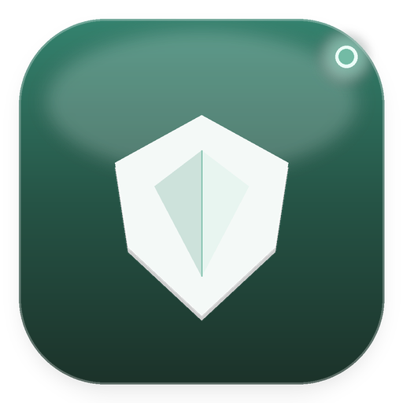
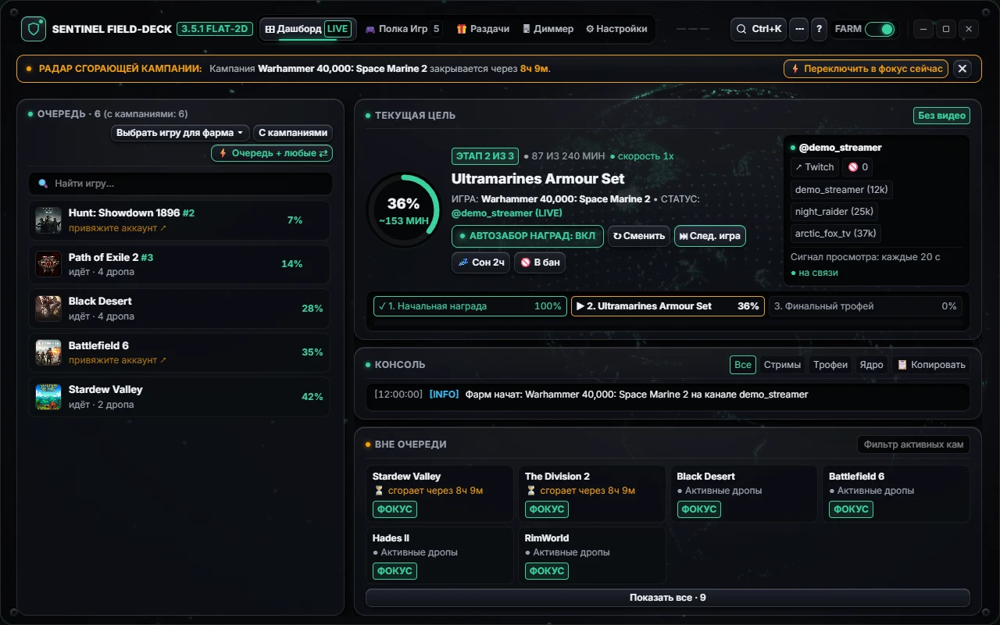
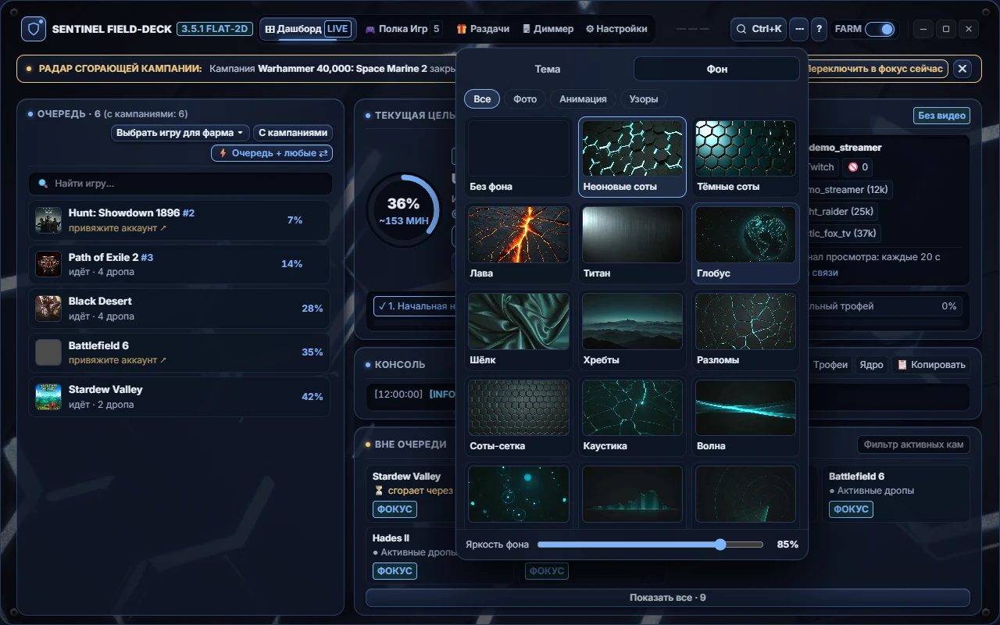
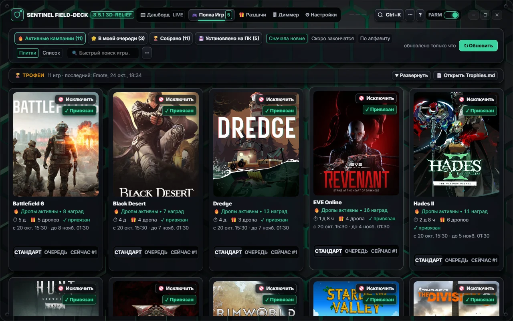
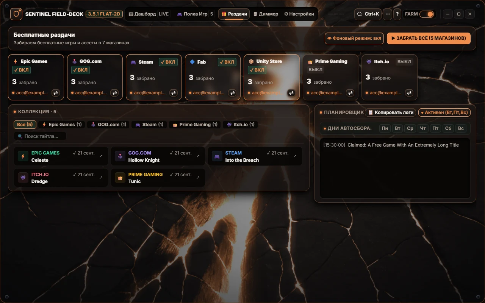
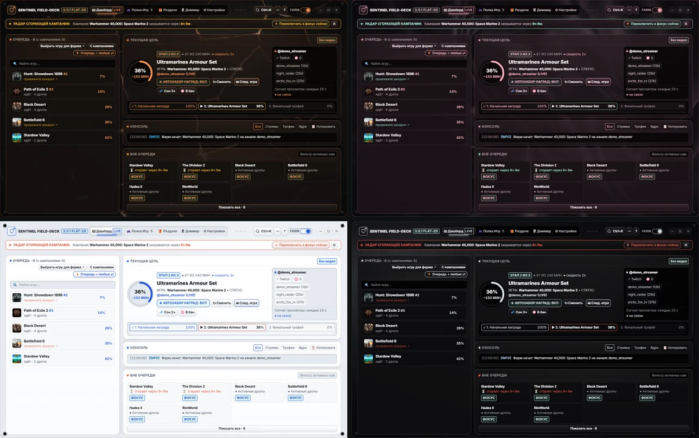
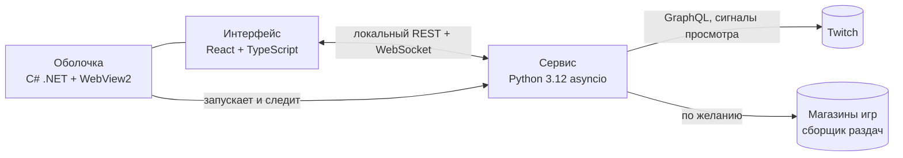

<div align="center">



# Twitch Drops Sentinel

**Собирает награды Twitch Drops в фоне на Windows, не включая видео.**

[English](README.md) · **Русский**

[](https://github.com/MortuisVMain/Twitch-Drops-Sentinel/releases/latest)
[](https://github.com/MortuisVMain/Twitch-Drops-Sentinel/releases)
[](https://github.com/MortuisVMain/Twitch-Drops-Sentinel/actions/workflows/ci.yml)

[](#лицензия)

[**Скачать для Windows**](https://github.com/MortuisVMain/Twitch-Drops-Sentinel/releases/latest)

</div>



Sentinel — программа для Windows, которая собирает Twitch Drops за вас. Вы выбираете игры, а он находит каналы с включёнными дропсами, копит время просмотра и забирает награды. Без вкладки браузера и без видеопотока: Twitch получает те же сигналы «минута просмотра», что и от обычного плеера, поэтому видеокарта свободна для игр, а трафика уходит мало.

## Возможности

- **Дропсы без видео.** Sentinel не скачивает и не декодирует стрим. Он отправляет сигналы просмотра и проверяет плейлист трансляции, и этого достаточно для прогресса наград.
- **Очередь приоритета.** Расставьте игры в нужном порядке. Три режима: только ваш список; сначала ваш список, потом любые другие кампании; сначала редкие и скоро заканчивающиеся дропсы.
- **Автосбор наград.** Награды забираются сразу, как только готовы, и попадают в журнал трофеев. Попутно собираются сундучки баллов канала.
- **Полка игр.** Все активные кампании с обложками, наградами, сроками и прогрессом. Установленные игры из Steam, Epic Games и GOG Galaxy (и из ваших папок) находятся автоматически.
- **Не мешает.** Фарм встаёт на паузу, пока вы играете в тяжёлую игру или работаете от батареи, и продолжается после. Когда всё собрано, Sentinel может усыпить или выключить компьютер.
- **Бесплатные игры.** Встроенный сборщик по расписанию забирает раздачи в Epic Games, GOG, Steam, Fab, Unity Asset Store, itch.io и Prime Gaming.
- **Диммер экрана.** Затемняет один или все мониторы ниже аппаратного минимума, есть режим полного затемнения для ночного фарма.
- **Внешний вид на ваш вкус.** 11 тем, 29 фонов (из них 17 фотореалистичных, которые перекрашиваются под тему), русский и английский интерфейс, размер текста от 70 до 130 %.
- **Обновляется сам.** Новые версии ставятся из GitHub Releases в один клик, вход, настройки и журнал трофеев сохраняются.

## Скриншоты

| Внешний вид: темы и фоны | Полка игр |
|---|---|
|  |  |
| **Бесплатные игры** | **Темы: Copper, Sakura Night, Paper, Graphite OLED** |
|  |  |

## Установка

1. Скачайте `Twitch_Drops_Sentinel_v…_Public_Release.zip` из [последнего релиза](https://github.com/MortuisVMain/Twitch-Drops-Sentinel/releases/latest).
2. Распакуйте в любую папку, куда можно записывать, например `C:\Games\Sentinel`.
3. Запустите `TwitchDropsSentinel.exe`.
4. Войдите: Sentinel откроет [twitch.tv/activate](https://www.twitch.tv/activate) с одноразовым кодом. Подтвердите его в браузере, пароль через программу не проходит.

**Требования:** Windows 10 или 11 (64-бит) и Microsoft Edge WebView2 Runtime, который в Windows 11 уже есть (если его нет, Sentinel предложит скачать). Python встроен. Вкладке «Раздачи» дополнительно нужен [Node.js](https://nodejs.org/) 20 или новее: он не входит в поставку, остальному приложению он не нужен. Браузерный движок для вкладки установится сам при первом запуске.

Подробная инструкция на русском: [docs/ИНСТРУКЦИЯ.md](docs/ИНСТРУКЦИЯ.md).

> [!TIP]
> Чтобы получать дропсы игры, аккаунт Twitch обычно нужно связать с аккаунтом игры. Такие кампании Sentinel помечает «привяжите аккаунт».

## Частые вопросы

<details>
<summary><b>Windows SmartScreen пишет, что приложение не распознано</b></summary>

Исполняемый файл не подписан сертификатом, поэтому SmartScreen предупреждает при первом запуске. Нажмите **Подробнее → Выполнить в любом случае**. Можно также посмотреть исходники и собрать программу самостоятельно (см. ниже).
</details>

<details>
<summary><b>Нужно держать открытым стрим или браузер?</b></summary>

Нет. Sentinel работает сам, его можно свернуть в трей. При закрытии окна он спросит, продолжать фарм в трее или выйти.
</details>

<details>
<summary><b>Где хранятся мои данные?</b></summary>

Только на вашем компьютере, рядом с программой: сессия (`cookies.jar`), настройки (`config.json`) и журнал трофеев (`Trophies.md`). Никуда, кроме самого Twitch (и магазинов, если пользуетесь сборщиком бесплатных игр), ничего не отправляется. Из диагностических отчётов токены вырезаются перед копированием.
</details>

<details>
<summary><b>Twitch это разрешает?</b></summary>

Автоматический просмотр — серая зона правил Twitch. Sentinel входит через официальный вход Twitch по коду и ведёт себя как обычный зритель, но используйте его на свой риск.
</details>

<details>
<summary><b>Как работают обновления?</b></summary>

Sentinel проверяет GitHub Releases и предлагает небольшой архив-патч. Он заменяет файлы на месте и перезапускается, сессия, настройки и трофеи остаются. Полный архив всегда можно скачать из Releases.
</details>

## Сборка из исходников

```powershell
git clone https://github.com/MortuisVMain/Twitch-Drops-Sentinel.git
cd Twitch-Drops-Sentinel
npm ci
npm run build                      # интерфейс -> dist/
pip install -r requirements.txt    # сервис на Python
dotnet run --project desktop/TwitchDropsSentinel.csproj
```

Тесты: `python test_sentinel_suite.py`. CI прогоняет их на каждый push.

## Как устроено



## Благодарности

Ядро фарма Twitch основано на [TwitchDropsMiner](https://github.com/DevilXD/TwitchDropsMiner) от DevilXD (MIT). Модуль бесплатных игр основан на [free-games-claimer](https://github.com/vogler/free-games-claimer) от Ralf Vogler (AGPL-3.0). Подробности в [THIRD_PARTY_NOTICES.md](THIRD_PARTY_NOTICES.md).

## Лицензия

MIT, см. [LICENSE](LICENSE). Папка `giveaways_engine/` распространяется по AGPL-3.0, см. [giveaways_engine/LICENSE](giveaways_engine/LICENSE).

Sentinel не связан с Twitch, Amazon или магазинами игр и не одобрен ими. Все товарные знаки принадлежат их владельцам.
