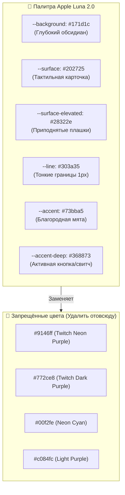
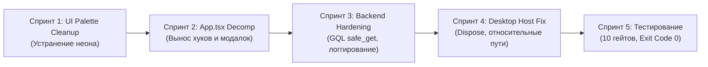

# ТЕХНИЧЕСКОЕ ЗАДАНИЕ (ТЗ) ДЛЯ GEMINI: КОМПЛЕКСНАЯ ДОРАБОТКА И ХАРДЕНИНГ TWITCH DROPS SENTINEL v3.0

> **Проект:** Twitch Drops Sentinel v3.0 [Apple Luna Edition]  
> **Автор и владелец:** Mortuis_V / Mortuis_V_Studio  
> **Статус:** Production / Local-First Desktop App  
> **Дата составления:** Октябрь 2026 г.  
> **Целевой исполнитель:** Gemini AI Agent (в связке со стандартами Antigravity / Critic Triad / Karpathy Guidelines)

---

## 📌 1. ПАСПОРТ ПРОЕКТА И ЦЕЛИ

### 1.1. Суть приложения
**Twitch Drops Sentinel v3** — автономный локальный комбайн для фонового сбора Twitch Drops без открытия видеопотоков в браузере (Streamless Engine), со встроенной системой мониторинга железа (Hardware Guard), автопаузой при запуске игр и автоматическим выключением ПК после завершения фарма (Luna Auto-Shutdown).

### 1.2. Текущий технологический стек
* **Frontend:** React 19, TypeScript 5.7, Tailwind CSS v4, Vite 7 (SingleFile Plugin), Lucide Icons, Web Audio API.
* **Backend:** Python 3.12+ (Aiohttp 3.9+, Asyncio, Psutil, Twitch GQL & EventSub/PubSub WebSocket).
* **Desktop Host:** C# (.NET 10 Windows Forms), Microsoft.Web.WebView2 (1.0.4191+), Win32 DWM API.
* **Платформа:** Windows 10/11 (x64), GPU NVIDIA RTX 5070 Ti, 32 GB RAM.

### 1.3. Главная цель доработки
Привести проект к **абсолютному эталону надёжности и эстетики**:
1. **Интерфейс (UI/UX):** 100% внедрение дизайн-системы **Apple Luna 2.0** — полное устранение остатков едкого фиолетового/голубого неона во всех компонентах, декомпозиция монолитного `App.tsx`, чистка CSS от дубликатов, строгая типографика с табличными числами.
2. **Код бэкенда (Python):** Защита от сбоев Twitch GQL (замена 32 небезопасных прямых обращений к словарям на `.get()`), ликвидация проглоченных ошибок (`except: pass`), устранение гонки в `self.watching_channel`, вынесение магических констант.
3. **Десктоп-хост (C#):** Корректная утилизация ресурсов WebView2 (`Dispose`), устранение жестко захардкоженных абсолютных путей, безопасное завершение фонового процесса.
4. **Тестирование и верификация:** 0 регрессий, расширение тестового набора до 10 гейтов, стабильный Exit Code 0.

---

## 🔍 2. АРХИТЕКТУРНЫЙ АУДИТ: ТЕКУЩИЕ ДЕФЕКТЫ И ТОЧКИ РОСТА

### 2.1. Фронтенд (`src/`)
1. **Остатки кислотного неона (Neon Remnants):**
   * В `src/components/GameSearchAutocomplete.tsx`: строки 282, 293, 314, 364, 376, 403, 437, 467 используют цвета `#9146ff`, `#c084fc`, `#00f2fe`.
   * В `src/components/GameShelf.tsx`: строки 61, 67, 91, 124, 150, 155, 162, 166, 191, 206 содержат фиолетовые и бирюзовые градиенты.
   * В `src/components/LiveDashboard.tsx`: строки 413, 415, 416, 421, 427, 434, 577, 629, 668, 678, 697, 708, 733, 757, 773 используют `#9146ff` и `#00f2fe` вместо палитры Luna.
   * В `src/components/Navigation.tsx`: строки 32, 39, 59 используют `#00f2fe` и градиенты `#8232f0` -> `#6d20e0`.
2. **Монолитный `src/App.tsx` (684 строки в одной функции):**
   * Функция компонента `App` занимает строки со 105 по 789. В ней смешаны: polling-логика состояния, локальный таймер обратного отсчета, обработка hotkeys (F5, F11, Space), рендеринг модальных окон (HelpModal, GameSearchModal), тосты и навигация.
   * Неиспользуемые импорты: `Terminal`, `Activity` из `lucide-react` (строки 30–31).
3. **Дефекты `src/index.css`:**
   * Дублирующиеся селекторы: `.sidebar` (3 раза), `.apple-feature-item` (2 раза), `.brand`, `.topbar`, `.main-shell` (остатки старых версий верстки).
   * Отсутствуют переменные `--surface-elevated` и `--card-bg` в `:root`.
   * В корне проекта отсутствует `@theme` конфигурация токенов Luna для Tailwind v4.

### 2.2. Бэкенд (`core/`)
1. **Небезопасный доступ к полям Twitch GraphQL (`core/inventory.py`):**
   * Найдено **32 прямых обращения** вида `data["benefit"]`, `data["benefitEdges"][0]`, `data["startAt"]`. При изменении схемы Twitch API это вызывает фатальный `KeyError`/`IndexError`.
2. **Подавление ошибок без логирования (Silent Failure Anti-Pattern):**
   * `core/cache.py` (L108, L115): `except Exception: pass` при повреждении кэша картинок.
   * `core/gui_headless.py` (L74): `except Exception: pass` при тостах.
   * `core/inventory.py` (L82, L232, L301): тихий возврат `False` при ошибках клейма наград.
   * `core/sentinel_service.py` (L69, L259, L501, L385, L458): ошибки в HTTP-ручках возвращают 500, но не пишут трейсбек `logger.error(..., exc_info=True)`.
   * `core/twitch.py` (L482): тихая очистка `cookie_jar` при ошибке чтения файла.
3. **Гонка потоков в `self.watching_channel` (`core/twitch.py`):**
   * Объект `AwaitableValue` очищается через `.clear()` и заполняется через `.set()`. Между этими вызовами цикл `_watch_loop` может зависнуть в ожидании следующего канала, если смена канала произошла во время отката сессии. Отсутствует мьютекс `asyncio.Lock`.
4. **Синхронный блокирующий I/O в `core/campaigns_fetcher.py`:**
   * Использование `urllib.request.urlopen` (L72) вместо `aiohttp.ClientSession`. При отсутствии сети вызов блокирует поток до таймаута. При сбое кэша возвращает пустой список без уведомления.
5. **Магические числа:**
   * Порт `28492` захардкожен в 6 местах; таймауты watchdog (10, 20, 60 секунд) разбросаны по коду без общего конфига.

### 2.3. Десктоп-хост (`desktop/MainForm.cs`)
1. **Утечка процессов WebView2:** Отсутствует вызов `_webView.Dispose()` при закрытии формы (`OnFormClosing`).
2. **Жестко захардкоженные абсолютные пути:**
   * Строка 156: `@"C:\AI Local Projects\Ideas\Twitch Drops Sentinel v3\core\sentinel_service.py"` делает приложение непереносимым на другие ПК.
   * Строки 174–178: жесткие пути поиска Python.
3. **Агрессивный kill процесса:** При закрытии приложения `_pythonBackendProcess.Kill(true)` вызывается до того, как Python успевает гарантированно сбросить `Trophies.md` и `config.json` на диск.

---

## 🎨 3. СТАНДАРТ ДИЗАЙН-СИСТЕМЫ APPLE LUNA 2.0 (ZERO AI-SLOP)

Все визуальные элементы должны строго соответствовать дизайн-контракту **Apple Luna 2.0**:



### 3.1. Ключевые токены и правила верстки:
1. **Цвета:**
   * Фоновый каркас: `#171d1c`
   * Поверхности карточек: `#202725`
   * Фокусные/активные элементы: `#368873` (фон) и `#73bba5` (бордер, акцентный текст)
   * Разделители: `1px solid #303a35`
   * Текст: Основной `#e9eeec`, Приглушенный `#9ba3a0`
2. **Типографика и цифры:**
   * Все таймеры, мегабайты, счетчики наград, проценты и пинг ОБЯЗАНЫ иметь класс `tabular-nums` (`font-variant-numeric: tabular-nums`).
   * Никаких скачущих ширин колонок при смене цифр.
3. **Тактильные переключатели:**
   * Использовать `.studio-switch` и `.studio-switch.checked` со сглаженной физикой Apple (`cubic-bezier(0.16, 1, 0.3, 1)`).
4. **Интерактивные зоны:**
   * Минимальная кликабельная зона кнопок — $\ge 40\text{px}$ (в идеале $\ge 48\text{px}$ для мобильных).
   * Пружинный отклик при нажатии: `active:scale-95`.

---

## 🛠️ 4. ТРЕБОВАНИЯ К ДОРАБОТКЕ КОДА (КАРПАТИ + PYTHON MASTERY)

### 4.1. Принципы Андрея Карпати:
* **Simplicity First (200 строк -> 50):** Минимальный код, решающий задачу. Никаких спекулятивных абстракций, фабрик фабрик и неиспользуемых параметров.
* **Surgical Changes:** Трогать только то, что необходимо. Не трогать работающие части движка.
* **Spec Wins Over Broken Tests:** Если тест противоречит спецификации, правится тест, а не архитектура. Сохранять сигнатуру `Mortuis_V_Studio` в `SettingsStudio.tsx`!

### 4.2. Python Mastery (Стандарты надежности):
1. **Защита GQL:** Заменить все `data["key"]` на `data.get("key", default)`. Для цепочек вложенности создать хелпер:
   ```python
   def safe_get(d: dict, *keys, default=None):
       for k in keys:
           if not isinstance(d, dict):
               return default
           d = d.get(k)
       return d if d is not None else default
   ```
2. **Логирование ошибок:** Никаких пустых `except Exception: pass`. Все исключения логировать через `logger.error("Context message: %s", err, exc_info=True)`.
3. **Устранение гонок:** Добавить `asyncio.Lock()` вокруг операций переключения каналов в `Twitch`.
4. **Магические числа:** Вынести порт `28492` и таймауты в `core/constants.py` (`DEFAULT_SERVICE_PORT = 28492`).

### 4.3. Рефакторинг Frontend (`src/`):
1. **Декомпозиция `App.tsx`:**
   * Вынести управление опросом состояния в кастомный хук `src/hooks/useSentinelState.ts`.
   * Вынести локальный таймер обратного отсчета в хук `src/hooks/useActiveDropCountdown.ts`.
   * Вынести модальное окно помощи в `src/components/HelpModal.tsx`.
   * Сократить `App.tsx` с 789 строк до $< 250$ строк!
2. **Чистка `src/index.css`:**
   * Удалить дублирующиеся блоки `.sidebar`, `.topbar`, `.apple-feature-item`.
   * Добавить переменные `--surface-elevated: #28322e`, `--card-bg: #202725`.
   * Прописать директиву `@theme` для Tailwind v4.

### 4.4. Доработка Desktop Host (`desktop/MainForm.cs`):
1. **Устранение жестких путей:**
   * Использовать `Path.Combine(AppDomain.CurrentDomain.BaseDirectory, @"..\..\..\core\sentinel_service.py")` с fallback на проверку локальной папки `./core/sentinel_service.py`.
2. **Корректный Dispose:**
   * В `OnFormClosing` вызывать `_webView?.Dispose()`.
3. **Безопасное завершение Python:**
   * Отправлять `/api/shutdown`, ждать до 3 секунд с чтением stdout, и только потом вызывать `Kill()`, если процесс не завершился сам.

---

## 📋 5. ПОШАГОВЫЙ ПЛАН РАБОТ (СПРИНТЫ ДЛЯ АГЕНТА)



### Спринт 1: Фронтенд — Зачистка неона и стиль Luna 2.0
* [ ] Заменить все цвета `#9146ff`, `#c084fc`, `#00f2fe` в `src/components/GameSearchAutocomplete.tsx` на `#73bba5` / `#368873` / `#202725`.
* [ ] Перевести градиенты и бейджи в `src/components/GameShelf.tsx` на палитру Luna.
* [ ] Очистить `src/components/LiveDashboard.tsx` от фиолетовых и голубых иконок и бейджей.
* [ ] Перевести `src/components/Navigation.tsx` на обсидиановые плашки с мятными индикаторами.
* [ ] Удалить неиспользуемые импорты (`Terminal`, `Activity`) в `App.tsx`.

### Спринт 2: Фронтенд — Архитектурный рефакторинг `App.tsx` и `index.css`
* [ ] Создать `src/hooks/useSentinelState.ts` и перенести туда логику `fetchState` и интервала.
* [ ] Создать `src/hooks/useActiveDropCountdown.ts` для тика секунд активного дропа.
* [ ] Создать `src/components/HelpModal.tsx` и вынести модалку справки.
* [ ] Очистить `src/index.css` от дублирующихся селекторов и добавить недостающие переменные.
* [ ] Запустить `npm run build` и подтвердить успешную сборку singlefile-бандла.

### Спринт 3: Бэкенд — Отказоустойчивость GQL и логирование
* [ ] Внедрить `safe_get` во все парсеры `core/inventory.py` (32 места).
* [ ] Заменить `except Exception: pass` на информативное логирование с `exc_info=True` в `cache.py`, `inventory.py`, `sentinel_service.py`, `twitch.py`.
* [ ] Добавить `asyncio.Lock()` для защиты `self.watching_channel` в `core/twitch.py`.
* [ ] Вынести порт `28492` в `core/constants.py`.

### Спринт 4: Десктоп C# — Портативность и чистое завершение
* [ ] Заменить абсолютный путь к `sentinel_service.py` в `MainForm.cs` на поиск относительно исполняемого файла.
* [ ] Добавить вызов `_webView?.Dispose()` при закрытии окна.
* [ ] Собрать релизный бинарник: `dotnet publish desktop/TwitchDropsSentinel.csproj -c Release -r win-x64 --self-contained true -p:PublishSingleFile=true -o publish`.
* [ ] Скопировать `publish\TwitchDropsSentinel.exe` в корень проекта.

### Спринт 5: Тестирование и приемка
* [ ] Добавить в `test_sentinel_suite.py` два новых проверочных гейта:
  - `[9/10] test_palette_integrity`: проверка отсутствия `#9146ff` и `#00f2fe` в компонентах `src/components/`.
  - `[10/10] test_safe_inventory_parsing`: тест парсинга сломанного/усеченного GQL-ответа без вылета `KeyError`.
* [ ] Запустить `python test_sentinel_suite.py` и получить **ALL 10 VERIFICATION GATES PASSED [SUCCESS]**.
* [ ] Перезапустить приложение на рабочем столе и убедиться в работоспособности.

---

## 🎯 6. КРИТЕРИИ ПРИЁМКИ (DEFINITION OF DONE)

1. ✅ **Код фронтенда:**
   * `src/App.tsx` содержит менее 300 строк кода.
   * `grep -rn "#9146ff" src/components/` возвращает **0 совпадений**.
   * `grep -rn "#00f2fe" src/components/` возвращает **0 совпадений**.
   * `npm run build` компилируется без предупреждений TypeScript с Exit Code 0.
2. ✅ **Код бэкенда:**
   * 0 незалогированных `except Exception: pass` в критических путях.
   * Ни одного падения с `KeyError` при обработке некорректных GQL-структур.
   * Порт `28492` централизован в `constants.py`.
3. ✅ **Десктоп:**
   * `TwitchDropsSentinel.exe` запускается из любой папки (без зависимости от пути `C:\AI Local Projects\...`).
   * WebView2 корректно освобождает память при закрытии.
   * Темный заголовок окна Windows 11 без синей полосы сохранен.
4. ✅ **Тестирование:**
   * Скрипт `python test_sentinel_suite.py` проходит все 10 гейтов с **Exit Code 0**.
   * Подпись `Mortuis_V_Studio` сохранена.

---

## 🛑 7. ПРАВИЛА И ОГРАНИЧЕНИЯ ДЛЯ АГЕНТА (RULES OF ENGAGEMENT)

1. **Не ломать рабочий функционал:**
   * Движок стримлесс-фарма, подключение к аккаунту Twitch (OAuth), сбор баллов канала, логирование в `Trophies.md` и детекция запущенных игр ДОЛЖНЫ работать бесперебойно.
2. **Контракт бренда:**
   * Сохранять строковые сигнатуры `Mortuis_V` и `Mortuis_V_Studio` в компонентах и тестах.
3. **Хирургическая точность:**
   * Не модифицировать файлы вне задач спринта.
   * После каждого спринта проверять билд и запуск тестов.
4. **Автономность:**
   * Выполнять задачи пошагово, верифицировать результат терминальными командами до объявления готовности.
