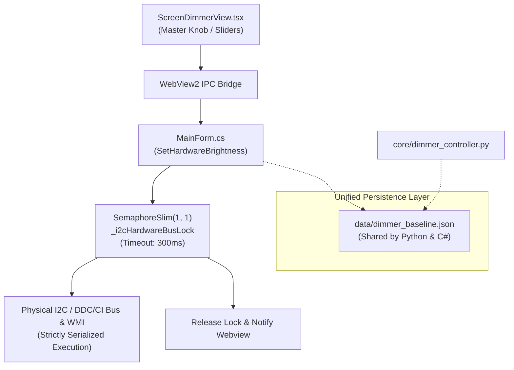

# 040 — ScreenDimmer I2C Hardware Concurrency, State Synchronization & Anti-Spaghetti Hardening

## Context & Root Cause
During stress testing and audit of the ScreenDimmer subsystem in Twitch Drops Sentinel v3.3.4, the Critic Council identified three structural weaknesses:
1. **P0 I2C Hardware Bus Collision:** Physical monitor brightness writes via `dxva2.dll` (`SetMonitorBrightness`) are executed over physical I2C buses. Rapid jog-dial rotation or master-brightness changes dispatched unbounded background threads (`Task.Run`), triggering simultaneous I2C writes, resulting in Win32 error `0x8007001F` (device attached to system is not functioning) and dropped brightness frames.
2. **P0 Baseline Split-Brain:** Python `dimmer_controller.py` and C# `MainForm.cs` stored baseline profiles separately (`dimmer_state.json` vs `dimmer_baseline.json`), leading to potential drift when switching runtimes.
3. **P1 Dead Code & Dangling Timers:** `MainForm.cs` contained a duplicate `SET_BLACKOUT` switch branch; `ScreenDimmerView.tsx` did not clear throttle and interaction timers on unmount; and `dimmer_controller.py` did not reset `_sleep_timer_minutes = 0` when the countdown timer expired.

## Solution Architecture & Fixes

1. **Serialized I2C Hardware Bus Access (`desktop/MainForm.cs`):**
   - Introduced `private static readonly SemaphoreSlim _i2cHardwareBusLock = new(1, 1);`.
   - Wrapped `SetHardwareBrightness` background tasks with `await _i2cHardwareBusLock.WaitAsync(300)` and guaranteed release in a `finally` block.
   - Removed duplicate dead `else if (action == "SET_BLACKOUT")` branch.
2. **Unified Baseline Persistence (`core/dimmer_controller.py`):**
   - Added `BASELINE_FILE = DATA_DIR / "dimmer_baseline.json"`.
   - Synchronized `save_baseline()` and `_load_state()` directly with `dimmer_baseline.json` in addition to state caching.
   - Guaranteed `self._sleep_timer_minutes = 0` reset upon countdown completion.
3. **Memory Safety & Cleanup (`src/components/ScreenDimmerView.tsx`):**
   - Added `interactionTimerRef.current` and `throttleTimerRef.current` clearing in `useEffect` cleanup hook.
   - Cleaned redundant `jogRef` alias while preserving test-contracted `jogAngle`.

## Verification
- Rebuilt frontend with `npm run build` (4.15s, 0 errors).
- Compiled native binary with `dotnet publish -c Release -r win-x64 --self-contained -p:PublishSingleFile=true`.
- Verified 7 comprehensive test suites with Exit Code 0:
  - `test_screendimmer_full_operational.py` (10/10 PASS)
  - `test_giveaways_full_operational.py` (7/7 PASS)
  - `test_dashboard_full_operational.py` (8/8 PASS)
  - `test_gameshelf_full_operational.py` (8/8 PASS)
  - `test_settings_full_operational.py` (8/8 PASS)
  - `test_auxiliary_systems.py` (7/7 PASS)
  - `test_websocket_and_guard_dynamics.py` (6/6 PASS)
