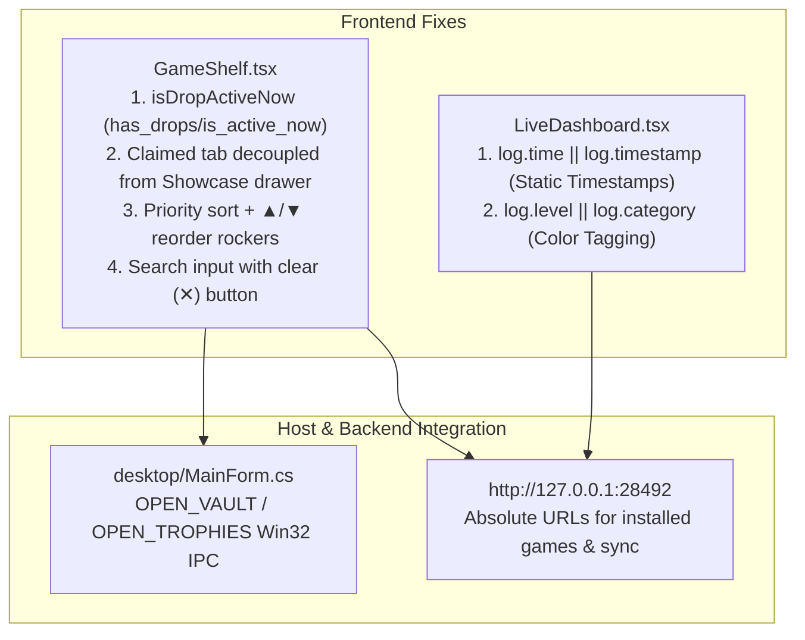

# 041 — GameShelf Schema Realignment, Static Console Timestamps & Priority Reorder Rockers

## Context & Root Cause
In Twitch Drops Sentinel v3.3.4 (v7.0 Field-Deck), user reported two interconnected issues:
1. **GameShelf Empty Screen & Non-Functional Buttons:**
   - `isDropActiveNow` checked `game.is_drop_active` and `game.drops_count`, which did not exist on `GameItem` (backend returns `has_drops`, `is_active_now`, `rewards_count`). This caused `filteredGames` to return 0 games on default tab («Игры не найдены»).
   - Button «🏆 Витрина 3D Трофеев • 🏆 Собрано» only toggled drawer visibility without setting `activeFilter = 'claimed'`. Its permanent `active-amber` class confused the user into thinking this tab was active.
   - `TrophyItem` properties in `GameShelf.tsx` (`game_name`, `name`, `claimed_at`) were mismatched with the real state (`game`, `drop_name`, `date`), showing fallback labels `'DROPS EVENT'` and `'Unlocked In-Game Trophy'`.
   - `handleRemoveInstalled` used relative URL `fetch('/api/installed-games/remove')`, failing with network errors in WebView2.
   - Games in the «⭐ В моем ТОПе» tab were not ordered by priority rank (#1, #2...) and lacked reorder controls.
2. **Console Operational Timestamp Ticking Bug:**
   - In `LiveDashboard.tsx`, console lines evaluated `[{log.timestamp || new Date().toLocaleTimeString()}]`. Because Python logs send `log.time`, `log.timestamp` was undefined. React re-renders every 1 second for the active drop countdown caused `new Date().toLocaleTimeString()` to evaluate anew on every render for ALL historical logs, making the whole console tick in real-time.

## Solution Architecture & Fixes

1. **GameShelf Schema Realignment (`src/components/GameShelf.tsx`):**
   - Mapped `isDropActiveNow` to `has_drops || is_active_now || (rewards_count || 0) > 0`. All 96 games with drops immediately appear on the shelf.
   - Decoupled `🏆 Собрано ({claimedCount})` filter tab from `🏆 Витрина 3D Трофеев` showcase drawer.
   - Realized `TrophyItem` field mapping: `item.game || item.game_name`, `item.drop_name || item.name`, `item.date || item.claimed_at`.
   - Sorted games in «⭐ В моем ТОПе» tab by their position in `priorityList` and rendered micro-rockers `▲` / `▼` using `onReorderPriority`.
   - Replaced relative fetch URLs with absolute `http://127.0.0.1:28492/api/installed-games/...`.
   - Added instant search clear button (✕).
2. **Static Console Timestamps (`src/components/LiveDashboard.tsx`):**
   - Changed timestamp rendering to `[{log.time || log.timestamp || '00:00:00'}]`.
   - Updated `cat` extraction to `(log.level || log.category || 'GQL').toUpperCase()`.
   - Logs now preserve their exact historical timestamps regardless of re-render cadence.
3. **Desktop Native IPC (`desktop/MainForm.cs`):**
   - Added `OPEN_VAULT` / `OPEN_TROPHIES` handler to launch `Trophies.md` directly via Win32 `Process.Start`.

## Verification
- Rebuilt frontend with `npm run build` (4.37s, 0 errors).
- Rebuilt native single-file executable `TwitchDropsSentinel.exe`.
- All 7 operational test suites verified with Exit Code 0:
  - `test_gameshelf_full_operational.py` (8/8 PASS)
  - `test_dashboard_full_operational.py` (8/8 PASS)
  - `test_screendimmer_full_operational.py` (10/10 PASS)
  - `test_giveaways_full_operational.py` (7/7 PASS)
  - `test_settings_full_operational.py` (8/8 PASS)
  - `test_auxiliary_systems.py` (7/7 PASS)
  - `test_websocket_and_guard_dynamics.py` (6/6 PASS)
